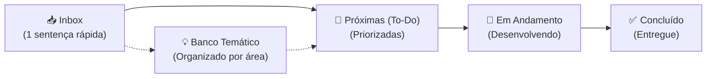

## 📥 Inbox (Captura Rápida)

- [ ] A caixa de busca "Busca disciplina, docente ou texto..." deve permitir filtrar células por:
    - Sigla da disciplina;
    - Nome da disciplina;
    - Turma da disciplina, com regex resiliente, por exemplo T01, t01 T1, t1, T-01, t-1;
    - Nome do docente, inclusive quando houver mais que um docente;
    - Modalidade Teórica ou Prática
    - Período Semestral ou Anual
    - Qualquer palavra do campo observações
    
- [ ] Atualizar para o Janus
    Todas as funcionalidades que foram criadas para as células de Graduação, devem ser replicadas para as células das diciplinas de pós-graduação. A diferença aqui é que depois de fazer o parser da página da disciplina do Janus, será necessário buscar uma URL no formato "https://uspdigital.usp.br/janus/publico/turma/<SIGLA DA DISCIPLINA>/<ALGUM DÍGITO>", acessar essa url e fazer um novo parser para, daí sim conseguir os dados da disciplina.

---

# 📋 Backlog & Banco de Ideias — Alocação Plus

> **Espaço ágil para captura e evolução de ideias, melhorias e tarefas pendentes.**  
> 💡 *Regra de Ouro:* Anote rápido na **Inbox** em apenas uma sentença. O refinamento e o detalhamento acontecem depois, quando for hora de implementar!

---

## ⚡ Fluxo de Trabalho (Workflow)

1. **Capturar:** Teve uma ideia ou notou um ponto de melhoria? Adicione imediatamente uma nova linha em [📥 Inbox (Captura Rápida)](#-inbox-captura-rápida).
2. **Refinar:** Periodicamente, mova itens da Inbox para [🎯 Próximas (To-Do)](#-próximas--prioritárias-to-do) ou para as categorias do [💡 Banco Temático](#-banco-de-ideias--melhorias-futuras-icebox).
3. **Executar:** Ao começar o desenvolvimento, mova para [🚧 Em Andamento](#-em-andamento-in-progress). Ao concluir, marque como feito e mova para [✅ Concluído](#-concluído-done).

> 💡 **Dica de Terminal:** Você também pode anotar ideias direto pelo terminal sem abrir o arquivo:  
> `python tools/gas_sync.py idea "Sua ideia aqui em uma frase"`

---

## 🎯 Próximas / Prioritárias (To-Do)
<!-- Ideias já refinadas e prontas para desenvolvimento nos próximos ciclos -->

---

## 💡 Banco de Ideias & Melhorias Futuras (Icebox)
<!-- Ideias categorizadas para consulta e planejamento estratégico -->

### 🎨 Interface, UX & Mobile
- [ ] Adicionar suporte a Dark Mode respeitando a preferência do sistema operacional (`prefers-color-scheme`).
- [x] Adicionar micro-animações nas transições dos chips de filtros para feedback tátil mais suave.
- [ ] Reparar a barra de rolagem da maior janela para que passe a funcionar no mobile
- [ ] Otimizar a disposição dos cartões de horário em telas pequenas (mobile).

### 🔍 Busca, Filtros & Usabilidade
- [ ] Sugerir termos comuns automaticamente no campo de busca ao começar a digitar.

### ⚡ Desempenho, Cache & Backend

### 🛠️ Automação, DX & Ferramentas
- [ ] Adicionar validação de formatação e lint nos arquivos `.gs` e `.html` antes do envio.
- [ ] Criar script de teste automatizado para validar integridade do parser de células mescladas.
- [x] Criar uma ferramenta de teste automatizado (`tests/run_all_tests.py` com relatórios coloridos e suporte UTF-8/Windows).
---

## 🚧 Em Andamento (In Progress)
<!-- O que está sendo desenvolvido no momento -->

*(Nenhuma tarefa em andamento no momento)*

---

## ✅ Concluído (Done)
<!-- Histórico de melhorias entregues (com indicação da versão) -->

- [x] **v1.2.1:** Padronização Visual e Micro-Animações Táteis ("Efeitos Fofinhos") nos Botões do Card Flutuante:
  - Eliminação da inconsistência de altura física (2px) entre o botão Fechar e os botões outline no rodapé;
  - Transições em curva de mola `cubic-bezier(0.34, 1.56, 0.64, 1)` com elevação no hover (`translateY(-1px)`) e contração física no clique (`scale(0.96)` / `scale(0.95)` em 0.05s) para todos os botões (turmas inativas e ativas, abrir no Jupiterweb, filtrar grade e fechar);
  - Agrupamento harmonioso no rodapé (link informativo à esquerda e ações operacionais à direita);
  - Criação do ADR 0014 e do guia de Design System `docs/padroes-interface-botoes.md` para governança futura;
  - Suporte completo a `@media (prefers-reduced-motion: reduce)`.
- [x] **v1.2.0:** Telemetria e Contador de Acessos Nativo no Google Sheets:
  - Registro silencioso e assíncrono em segundo plano (0ms de impacto no carregamento e renderização da grade);
  - Identificador anônimo aleatório no `localStorage` para cálculo de visitantes únicos e frequência diária (LGPD-compliant);
  - Detecção automática de tipo de dispositivo (Mobile vs. Desktop) e resolução de tela;
  - Proteção de concorrência via `LockService` e debounce de 15 minutos por sessão contra reloads consecutivos;
  - Criação e formatação automática da aba `_Metricas` na planilha PLUS com fórmulas em tempo real (Total de Consultas, Visitantes Únicos, Acessos Hoje, % Mobile/Desktop);
  - Adição da opção `📊 Abrir Métricas` no menu oficial `💡 Plus` da planilha.
- [x] **v1.0.0:** Primeiro grande lançamento oficial estável (*Major Release*):
  - Enriquecimento progressivo assíncrono de disciplinas com dados oficiais do Jupiterweb (USP);
  - Tooltip dinâmico no hover com docente(s) e Card Modal elegante com turmas, vagas, horários oficiais e observações;
  - Fila reativa com concorrência estrita (1 lote em voo de até 3 disciplinas) e priorização inteligente de viewport;
  - Invalidação completa de cache (cliente `sessionStorage` e servidor `CacheService`) e feedback visual de carregamento ("Conectando à grade oficial do SVGRAD...") ao clicar no botão "Atualizar Dados";
  - Suíte unificada de testes automatizados com 25 testes (unitários, edge cases e property fuzzing) cobrindo parsers, casamento de turmas e máquina de estados da fila.
- [x] **v0.3.0:** Enriquecimento progressivo de disciplinas da graduação com dados do Jupiterweb (motor assíncrono com concorrência estrita de 1 requisição em voo, cache multinível com `sessionStorage` e `CacheService` de 6h, tooltip dinâmico com docente no hover e Card Modal elegante com turmas, distribuição de vagas, horários e observações no clique, mantendo 0ms de tempo de renderização da grade).
- [x] **v0.3.0:** Suíte de testes automatizados unificada (`tests/run_all_tests.py`) com 23 testes unitários e property fuzzing cobrindo parser HTML do Jupiterweb, casamento de turmas e máquina de estados da fila.
- [x] **v0.3.0:** Micro-animações e feedback tátil fluido em todos os botões e links da aplicação (chips de filtros, botões de ação rápida, ações da grade e links de disciplinas do Jupiterweb e Janus na tabela), com suporte completo a `prefers-reduced-motion` e prevenção de atraso de toque em dispositivos móveis.
- [x] **v0.2.0:** Destaque visual do horário vigente e do dia de hoje no cabeçalho (cores temáticas do botão Agora/Hoje, prefixo com símbolo "⚡ " e tipografia em negrito).
- [x] **v0.1.4:** Implementação da sincronização seletiva de arquivos no comando `gas_sync.py push <arquivo>`.
- [x] **v0.1.3:** Estrutura formal de versionamento SemVer (`version.json`) e contador de build automático integrado ao `watch`.
- [x] **v0.1.2:** Suporte a links diretos para turmas no Jupiterweb (graduação) e Janus (pós-graduação).
- [x] **v0.1.1:** Arquitetura de cache multinível em blocos (*chunking*) para contornar o limite de 100KB do `CacheService`.
- [x] **v0.1.0:** Migração da antiga Sidebar para Web App autônomo responsivo.
