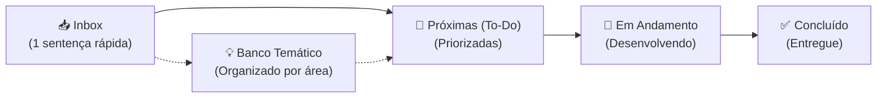

## 📥 Inbox (Captura Rápida)

---

- [ ] Colocar fotos de docentes no cartão flutuante
- [ ] Capturar mais dados das visitas ao site
- [ ] Inserir botões de filtro rápido Manhã / Tarde
- [ ] Criar configurações persistentes para preferências: horário, sala, dia etc.
- [ ] Colocar uma opção na janela de configuração de impressão para exibir o nomes do docente

# 📋 Backlog & Banco de Ideias — Alocação Plus

> **Espaço ágil para captura e evolução de ideias, melhorias e tarefas pendentes.**  
> 💡 *Regra de Ouro:* Anote rápido na **Inbox** em apenas uma sentença. O refinamento e o detalhamento acontecem depois, quando for hora de implementar!

---

## ⚡ Fluxo de Trabalho (Workflow)

1. **Capturar:** Teve uma ideia ou notou um ponto de melhoria? Adicione imediatamente uma nova linha em [📥 Inbox (Captura Rápida)](#-inbox-captura-rápida).
2. **Refinar:** Periodicamente, mova itens da Inbox para [🎯 Próximas (To-Do)](#-próximas--prioritárias-to-do) ou para as categorias do [💡 Banco Temático](#-banco-de-ideias--melhorias-futuras-icebox).
3. **Executar:** Ao começar o desenvolvimento, mova para [🚧 Em Andamento](#-em-andamento-in-progress). Ao concluir, marque como feito e mova para [✅ Concluído](#-concluído-done).

> 💡 **Dica de Terminal:** Você também pode anotar ideias direto pelo terminal sem abrir o arquivo:  
> `python tools/gas_sync.py idea "Sua ideia aqui em uma frase"`

---

## 🎯 Próximas / Prioritárias (To-Do)
<!-- Ideias já refinadas e prontas para desenvolvimento nos próximos ciclos -->

---

## 💡 Banco de Ideias & Melhorias Futuras (Icebox)
<!-- Ideias categorizadas para consulta e planejamento estratégico -->

### 🎨 Interface, UX & Mobile
- [x] Exibir mensagem centralizada na mesma linha de "Exibindo xx de xx salas" durante o carregamento dinâmico ("Carregando dados do Jupiterweb/Janus: x%") com cor azul marinho idêntica ao fundo do cabeçalho de salas.
- [ ] Adicionar suporte a Dark Mode respeitando a preferência do sistema operacional (`prefers-color-scheme`).
- [x] Adicionar micro-animações nas transições dos chips de filtros para feedback tátil mais suave.
- [ ] Reparar a barra de rolagem da maior janela para que passe a funcionar no mobile
- [ ] Otimizar a disposição dos cartões de horário em telas pequenas (mobile).

### 🔍 Busca, Filtros & Usabilidade
- [x] Sugerir termos comuns automaticamente no campo de busca ao começar a digitar (chips rápidos de departamentos, docentes e navegação por teclado na v1.4.0).

### ⚡ Desempenho, Cache & Backend

### 🛠️ Automação, DX & Ferramentas
- [ ] Adicionar validação de formatação e lint nos arquivos `.gs` e `.html` antes do envio.
- [ ] Criar script de teste automatizado para validar integridade do parser de células mescladas.
- [x] Criar uma ferramenta de teste automatizado (`tests/run_all_tests.py` com relatórios coloridos e suporte UTF-8/Windows).
---

## 🚧 Em Andamento (In Progress)
<!-- O que está sendo desenvolvido no momento -->

*(Nenhuma tarefa em andamento no momento)*

---

## ✅ Concluído (Done)
<!-- Histórico de melhorias entregues (com indicação da versão) -->

- [x] **v1.10.2:** Correção de Ergonomia e Boas Práticas de UX no Posicionamento e Estilos de Botões em Modais (ADR 0026):
  - **Alinhamento ao Fluxo de Leitura Natural (LTR / Diagrama de Gutenberg):** Correção do posicionamento em modais de confirmação (`#modal-impressao-grade`), posicionando a ação afirmativa/submissão (`🖨️ Imprimir / Salvar PDF`) no canto inferior direito (*terminal area*) e o botão de desistência (`Cancelar`) à esquerda;
  - **Hierarquia Visual Restaurada:** A ação primária de confirmação passa a receber estilo sólido institucional (`.btn-imprimir-confirmar`, fundo azul USP `#104880` e texto branco), enquanto o botão `Cancelar` passa a adotar estilo secundário outline (`.btn-cancelar-modal`), eliminando cliques acidentais;
  - **Botão Fechar no Card Flutuante com Estilo Secundário:** Remoção do estilo sólido de alta saturação do botão `Fechar` (`.btn-fechar-modal`) do card flutuante de disciplinas, adotando estilo secundário outline, evitando que o mero encerramento da leitura ofusque as ferramentas operacionais do card (`Trocar de Sala ⇄`, `Filtrar disciplina`);
  - **Acessibilidade e Micro-Interações:** Ambas as classes contempladas nas animações táteis e registradas na media query `@media (prefers-reduced-motion: reduce)`;
  - **Governança e Testes Automatizados:** Decisão formalizada no [ADR 0026](docs/adr/0026-correcao-ergonomia-ux-botoes-modais-confirmacao.md) (emendando o ADR 0024) e validação unitária atualizada em `tests/test_print_logic.py` mantendo 152 testes automatizados com 100% de sucesso.
- [x] **v1.10.0:** Modo Desenvolvedor e Autoexclusão de Telemetria via Parâmetro de URL (?dev=1) (ADR 0025):
  - **Autoexclusão Persistente no Navegador:** Ativação descomplicada via parâmetro de URL (`?dev=1` ou `?dev=true`) salvando a preferência em `localStorage` (`alocacao_plus_ignorar_telemetria = true`), permitindo que manutenções e testes diários do administrador não poluam as estatísticas de uso em `_Metricas`;
  - **Cancelamento Imediato no Cliente (Zero Overhead):** A rotina `registrarAcessoSilencioso()` aborta de imediato no navegador antes de checar conexões ou timers, poupando 100% de cotas de execução do Apps Script e eliminando escritas concorrentes na planilha;
  - **Identificação Visual Transparente (`DEV`):** Inclusão de badge semântico `#badge-dev-mode` (`DEV`) estilizado no Design System EESC ao lado do número de versão no cabeçalho e notificação Toast confirmatória na ativação e desativação;
  - **Reversibilidade Simples:** Permite restaurar o envio normal de telemetria a qualquer momento via `?dev=0` (ou `?dev=false`);
  - **Defesa em Profundidade no Backend:** O endpoint `registrarAcessoWeb(payload)` em `alocacao-plus.gs` rejeita payloads marcados com flags de teste (`isDev` ou `ignorar`);
  - **ADR 0025 e Testes Automatizados:** Decisão documentada no [ADR 0025](docs/adr/0025-modo-desenvolvedor-e-supressao-de-telemetria.md) e suíte unitária `tests/test_dev_mode_telemetria.py` elevando os testes automatizados para 152 testes (100% de sucesso).
- [x] **v1.9.1:** Padronização de Posicionamento e Estilos de Botões em Modais e Ações (ADR 0024):
  - **Formatação Homogênea na Barra de Ações:** O botão `🖨️ Imprimir Grade` adota a mesma identidade visual táctil de `🧹 Limpar Filtros` (`.btn-reset`);
  - **Identidade Visual de Ação em Modais:** O botão `🖨️ Imprimir / Salvar PDF` do modal adota a formatação estilizada de ação institucional (`.btn-link-externo-jupiter` / `.btn-imprimir-confirmar`);
  - **Regra Universal de Posicionamento Espacial:** Formalização da diretriz de UX onde botões de Fechar/Cancelar/Voltar posicionam-se estritamente à direita e botões de ação e confirmação (OK/Confirmar/Imprimir/Salvar) posicionam-se à esquerda ou centralizados em todos os modais;
  - **ADR 0024 e Testes Automatizados:** Registrado formalmente no [ADR 0024](docs/adr/0024-padronizacao-posicionamento-e-estilos-de-botoes-em-modais-e-acoes.md) e coberto por testes unitários em `tests/test_print_logic.py` (elevando a suíte para 144 testes automatizados com 100% de sucesso).
- [x] **v1.9.0:** Preparação e Impressão Inteligente da Grade Horária (Papel e PDF):
  - **Quebra da Barreira de SPAs no Navegador:** Reset completo e em cascata de `html, body`, `.app-main`, `.grade-section` e `.grade-scroll-wrapper` em `@media print`, eliminando o corte de páginas em `100vh` e permitindo paginação contínua da grade em múltiplas folhas;
  - **Cabeçalho Institucional Oficial para Impressão:** Inclusão de `#cabecalho-impressao-papel` (`.apenas-impressao`) com identificação formal da USP/EESC, resumo dinâmico de todos os filtros ativos e carimbo temporal de emissão no fuso de Brasília;
  - **Paleta em Escala de Cinza Econômica (Tinta & Toner):** Eliminação de fundos escuros e saturados com retorno das células a fundo branco (`#ffffff`), distinção tátil e visual de Graduação vs. Pós-Graduação através de borda sólida vs. borda dupla (`4.5px double #0f172a`) e marcador tipográfico `[PÓS]`, reduzindo o consumo de tinta/toner em mais de 90%;
  - **Modo Colorido (Fidelidade Web):** Preservação dos azuis oficiais com calibração `-webkit-print-color-adjust: exact; print-color-adjust: exact;` e proteção automática para células com enriquecimento pendente;
  - **Densidade Compacta & Ocultação de Lugares:** Redução otimizada de padding e tipografia (`body.impressao-compacta`) e opção de ocultar a coluna de capacidade (`body.impressao-sem-lugares`), permitindo acomodar 30-50% mais salas e horários em folha A4 Paisagem;
  - **Neutralização de Destaques Visuais:** Ocultação do ícone de raio (`⚡`) do cabeçalho via isolamento em `.icone-tempo-grade` e remoção dos fundos amarelos de hoje/agora (`.dia-hoje-atual`, `.col-slot-atual`), busca (`.celula-destacada-busca`) e foco (`.celula-ativa-modal`);
  - **Modal Interativo & Atalhos de Teclado:** Abertura via botão `🖨️ Imprimir Grade` ou atalho global `Ctrl + P` / `Cmd + P`, com suporte a `Enter` (confirmar) e `Esc` (cancelar), alerta dinâmico de colunas para ajustes de escala e restauração idempotente do DOM no `afterprint`;
  - **Qualidade & Testes Automatizados:** Criação da suíte `tests/test_print_logic.py` com testes unitários e property fuzzing, elevando a suíte para 143 testes automatizados (100% de sucesso);
  - **Documentação:** Especificação técnica detalhada em `docs/preparacao-e-impressao-grade.md`.
- [x] **v1.8.0:** Destaque do Próximo Bloco de Horário Durante Intervalos e Pré-Expediente na Grade:
  - **Destaque Dinâmico com Identidade Visual Padronizada:** Durante os intervalos entre aulas (recessos matutino e vespertino de 10-20 min, almoço e jantar) e pré-expediente matutino, o próximo bloco letivo a iniciar recebe o destaque visual padrão existente da aplicação (fundo amarelo suave e ícone de raio `⚡ ` na classe `.col-slot-atual`), dispensando a introdução de novos estilos ou tags no DOM e preservando a elegância e simplicidade da interface;
  - **Prevenção de Falsos Intervalos:** Resolução temporal avaliada contra a grade mestra da universidade (`todosSlots`), garantindo que filtros de busca textual ou horários ocultando a aula corrente nunca marquem horários posteriores como intervalos indevidos;
  - **Formatação Amigável de Tempo:** Implementação de `formatarTempoRestanteGrade(diff)` para converter minutos em horas/minutos amigáveis (`em 15 min`, `em 1h 20min`, `em 2h`) no tooltip contextual (`title`);
  - **Qualidade & Testes Automatizados:** Criação da suíte `tests/test_intervalo_slot_logic.py` com testes unitários e property-based fuzzing em todos os 1.440 minutos do dia, elevando a suíte para 122 testes (100% de sucesso);
  - **Governança:** Registrado no ADR 0023.
- [x] **v1.7.1:** Inserção Contextual de Nome vs. Sigla nos Chips de Disciplinas do Autocomplete:
  - **Inserção Contextual no Campo de Busca:** Ao clicar ou teclar `Enter` em um chip de disciplina sugerido a partir de busca textual por nome (ex: *"Cálculo"*, *"Resistência"*, *"Física"*), o campo de pesquisa é preenchido com o nome oficial da disciplina (ex: *"Cálculo I"*, *"Resistência dos Materiais I"*) em vez de substituir abruptamente pela sigla;
  - **Preservação da Busca por Sigla/Código:** Buscas iniciadas por prefixos de departamentos (`"SMA"`, `"SET"`, `"SEM"`), códigos alfanuméricos completos (`"SMA0301"`, `"SET0188"`), substrings numéricas (`"0301"`) ou códigos numéricos do IFSC (`"760"`, `"7600005"`) mantêm o preenchimento exato da sigla;
  - **Escala Dual de Relevância e Desempate Determinístico:** Implementação de cálculo desacoplado (`pontuacaoSigla` vs `pontuacaoNome`) com faixas intercaladas não sobrepostas ({100, 85, 55} vs {95, 75, 65, 45}) e critério estável de ordenação por código alfanumérico em caso de empate;
  - **Resiliência e Fallback Seguro:** Fallback automático para a sigla quando a disciplina ainda não foi enriquecida no cache (`nome == codigo`), com proteção contra quebras de atributos no DOM via `escapeHtml()`;
  - **Refinamento de Tooltips:** Eliminação de repetições redundantes no atributo `title` do chip (`Filtrar por <VALOR> (<CÓDIGO>)`);
  - **Qualidade & Testes Automatizados:** Expansão da suíte `tests/test_autocomplete_logic.py` totalizando 113 testes automatizados (100% de sucesso);
  - **Governança:** Registrado no ADR 0022.
- [x] **v1.7.0:** Pesquisa Inteligente de Troca de Sala (Modo Salas Livres Automatizado) & Refinamentos de Layout:
  - **Ação Rápida no Card Modal:** Adicionado o botão `Trocar de Sala ⇄` (`U+21C4`) posicionado em segundo lugar no rodapé do modal (logo após o link do Júpiter/Janus), em conformidade visual com o Design System (`docs/padroes-interface-botoes.md`);
  - **Otimização de Espaço Horizontal:** Encurtamento do botão de filtro de disciplina para `Filtrar <DISCIPLINA>` (ex: *Filtrar SMA0356*), economizando mais de 60px horizontais e acomodando todos os 4 botões na mesma linha no desktop;
  - **Realocação do Indicador de Carregamento:** Deslocamento da mensagem *"Carregando dados do Jupiterweb/Janus"* e barra de progresso para a direita do espaço livre na barra de ações, alinhada diretamente ao lado do botão `🧹 Limpar Filtros`;
  - **Resolução Hierárquica de Horários & Múltiplas Aulas Semanais:** Preservação estrita do slot exato da célula clicada na grade para turmas com múltiplos dias semanais, com cálculo real de células mescladas de longa duração (`colspan`) sobre a matriz canônica da planilha e adaptação fluida para o primeiro horário oficial em caso de troca de aba;
  - **Extração Resiliente de Demanda:** Captura automática de `matriculados` (Graduação) e `vagas` (Pós-Graduação) com proteção ao valor `0` e fallback amigável caso os dados ainda estejam em carregamento no Skeleton;
  - **Limpeza Silenciosa e Filtragem Atômica:** Implementação de `limparBuscaSilenciosa()` para evitar re-renderizações intermediárias e roubo de foco do teclado, resetando blocos e salas para `'todos'` e aplicando dia, horário, capacidade mínima e modo de salas livres em um único ciclo de renderização;
  - **Navegação e Acessibilidade:** Scroll suave para a grade, desassociação de elemento focado órfão e Toast confirmatório contextualizado citando a sala de origem e parâmetros aplicados;
  - **Qualidade & Testes:** Criação da suíte `tests/test_troca_sala_logic.py` totalizando 107 testes automatizados (100% de sucesso);
  - **Governança:** Registrado no ADR 0021.
- [x] **v1.6.1:** Refinamento Visual do Card Modal (Largura Total do Campo de Alunos / Vagas):
  - Expansão da largura do container `.modal-alunos-dado` para 100% da largura útil do card (`display: flex; width: 100%;`), eliminando o aspecto de bloco reduzido (`fit-content`) e estabelecendo perfeita simetria visual com os demais blocos do modal (docentes responsáveis, horários oficiais e observações).
- [x] **v1.6.0:** Exibição de Alunos Matriculados (Graduação/Jupiterweb) e Vagas Oferecidas (Pós-Graduação/Janus) no Card Modal da Grade:
  - **Graduação (Jupiterweb):** Extração robusta no backend de contagem de alunos matriculados (`matriculados`) somando as categorias da tabela de distribuição de vagas (`colspan=2`, 5 células) e ignorando linhas subordinadas de cursos (6 células), com delimitação estrita entre `Matriculado` e `</table>`;
  - **Pós-Graduação (Janus):** Extração resiliente de vagas oferecidas (`vagas`) a partir da tabela de vagas (`intl_numeroVagas` / `Número de vagas`) no endpoint `TurmaDet`, mapeando dinamicamente o índice da coluna `Total`;
  - **Exibição Dinâmica no Card Modal:** Apresentação contextual entre `👥 Alunos Matriculados: [N]` (Graduação) e `👥 Número de Vagas: [N]` (Pós-Graduação) ao selecionar turmas por pills, com proteção estrita contra bugs de valores falsy (`0` válido) e fallback elegante para `"Não informado"`;
  - **Interface e Acessibilidade:** Estilização com tipografia tabular (`font-variant-numeric: tabular-nums`) e container semântico com leitor de tela reativo (`aria-live="polite"`);
  - **Invalidação e Isolamento de Cache:** Atualização de prefixos de cache do servidor (`JUP_V19_` e `JAN_V3_`) e do cliente (`alocacao_jupiter_v19_` e `alocacao_janus_v3_`), garantindo purga automática de dados legados no `sessionStorage` e no `CacheService`;
  - **Qualidade & Testes:** Criação da suíte `tests/test_modal_formatters.py` e atualização de testes em `test_jupiter_parser.py`, `test_janus_parser.py` e `test_lote_disciplinas.py`, totalizando 95 testes automatizados (100% de sucesso);
  - **Governança Arquitetural:** Documentado no ADR 0020.
- [x] **v1.5.4:** Otimização de Espaço Vertical, Camadas Sticky da Grade & Refinamento do Cabeçalho:
  - **Camadas Sticky no Scroll Horizontal (`z-index`):** Correção do deslizamento dos cabeçalhos de dias da semana (`.th-dia-header` com `z-index: 25`), que agora passam sob os cabeçalhos fixos de Salas e Lugares (`th.col-fixa-sala` e `th.col-fixa-cap` elevados para `z-index: 35 !important`), eliminando sobreposição visual indesejada;
  - **Refatoração do Botão "Atualizar Dados":** Estilo limpo e harmonizado com o design system via classe `.btn-header-recarregar`, com fundo consistente em outline institucional e micro-interação tátil suave;
  - **Maximização do Espaço Vertical da Grade:**
    - Remoção da barra de rodapé (`.app-footer`), liberando área útil de tela diretamente para exibição das salas e horários;
    - Realocação da identificação de versão (`.badge-versao`) para o cabeçalho superior ao lado do título "Alocação Plus", com estilo discreto sem borda de pílula, tipografia normal (sem negrito) e alinhamento na linha de base do título;
    - Eliminação da linha avulsa `.barra-resultados`, movendo o contador de resultados (`#txt-contador-resultados`) e a barra discreta de progresso de carregamento em segundo plano (`#status-carregamento-dinamico`) para dentro da barra de ações à direita da caixa de busca, economizando mais ~30px verticais;
  - **Responsividade & Alinhamento:** Estilos aprimorados para flexbox com quebra controlada em telas médias/móveis e layout fluido no desktop;
  - Registro de governança arquitetural no ADR 0019.
- [x] **v1.5.3:** Estabilização Dimensional da Caixa de Busca & Limpeza ao Primeiro Toque:
  - Estabilização dimensional definitiva da caixa de busca (`width: 290px;` fixo tanto em repouso quanto em foco), eliminando o salto de 60px (*Cumulative Layout Shift* = 0) e a quebra de alinhamento dos botões vizinhos;
  - Correção cirúrgica do botão de limpar busca (`×`): prevenção de `blur` prematuro via `onmousedown="event.preventDefault()"`, garantindo execução de `limparBusca()` ao primeiro toque (eliminação da necessidade de duplo clique e do deslocamento do botão sob o cursor);
  - Refinamento de alinhamento vertical (`top: 50%; transform: translateY(-50%)`) e dimensões ergonômicas de toque (`20x20px`) do botão `×`;
  - Alinhamento horizontal estrito em linha única dos atalhos rápidos no popover de busca (`.sugestoes-acoes-grid` com `flex-wrap: nowrap`, `white-space: nowrap` e popover expandido para `440px`), garantindo que "Limpar Filtros" permaneça alinhado à direita na mesma linha que "Horário de Agora" e "Focar em Hoje".
- [x] **v1.5.2:** Otimização dos Atalhos Rápidos da Busca & Botão Limpar Filtros:
  - Substituição do atalho "Salas Livres" pelo atalho "Limpar Filtros" (`🧹 Limpar Filtros`) nos chips rápidos de busca quando o campo está vazio;
  - Posicionamento no canto direito do container de atalhos rápidos via alinhamento CSS flexbox (`margin-left: auto`), com estilo sutil e feedback tátil no hover e navegação por teclado (`.chip-acao-direita`);
  - Invocação da rotina canônica `resetarTodosFiltros()` ao acionar o chip de limpeza;
  - Atualização da suíte de testes unitários em `tests/test_autocomplete_logic.py` cobrindo a nova estrutura de ações rápidas (100% de sucesso nos 83 testes).
- [x] **v1.5.1:** Chips da Busca Baseados Exclusivamente na Grade Atual & Resiliência do Estado Vazio:
  - Eliminação completa de listas semente estáticas (`DOCENTES_SEMENTE` e `DISCIPLINAS_SEMENTE`); índices de busca são derivados 100% da grade alocada no momento;
  - Extração canônica e unificada de turmas (`extrairTurmasNumericasDaCelula`) compartilhada entre indexação e filtragem de busca (DRY);
  - Varredura em passo único $O(1)$ da grade compilando disciplinas ativas, turmas ativas e frequências departamentais reais;
  - Filtragem estrita de docentes por turma alocada com fallback seguro para ocorrências sem turma (`temSemTurma`), eliminando chips fantasmas e ocorrências de "0 salas encontradas";
  - Suporte completo a departamentos puramente numéricos do IFSC (código `7600006` mapeado para `760`) e oferecimentos do Janus (`t.ofe`);
  - Ordenação dinâmica dos departamentos frequentes no estado vazio por volume real de aulas alocadas no semestre;
  - Resiliência no estado vazio: orientação contextual ao usuário quando a busca não retorna salas enquanto o carregamento em lote do Júpiterweb/Janus ainda está em execução;
  - Correção de contraste e acessibilidade no botão "Ver Todas as Salas" (`.btn-primary-outline` com cor `#104880` legível sobre fundo claro);
  - Formalização arquitetural no ADR 0018;
  - Expansão da suíte de testes de 72 para 83 testes automatizados (100% de sucesso).
- [x] **v1.5.0:** Coloração Progressiva da Grade, Priorização Geométrica no Viewport 2D & Consolidação do Card Modal:
  - Células da grade iniciam com cores neutras (`.celula-aula-pendente`), transitando suavemente (`transition: 0.4s`) para as tonalidades oficiais (azul céu para graduação e azul cobalto para pós) conforme cada lote é concluído pelo worker em segundo plano;
  - Micro-animação tátil (`celula-recem-carregada`) que sinaliza discretamente a prontidão do card modal;
  - Reestruturação completa do agendador com detecção geométrica do Viewport 2D (interseção das salas visíveis e colunas de horários visíveis no container da tabela);
  - Prioridade 1 estrita para as células atualmente na tela, consumidas na ordem natural de leitura (de cima para baixo, da esquerda para a direita);
  - Prioridade 2 para extensões horizontais, salas abaixo da rolagem e salas filtradas;
  - Reordenação dinâmica real da fila ao rolar a grade (scroll vertical ou horizontal com debounce reduzido para 150ms);
  - Promoção instantânea para Prioridade 0 (urgência máxima) com abertura do card modal em esqueleto animado (*skeleton shimmer*) ao clicar em qualquer disciplina pendente;
  - Remoção da setinha indicadora de link externo (`↗`) nas células da grade (`.celula-aula a`, `.celula-pos a`, `.link-disc`), alinhando o feedback visual com a abertura do Card Modal interno;
  - Preservação das setas `↗` estritamente nos botões de abertura externa no rodapé do Card Modal;
  - Remoção da linha de consultas diretas externas do rodapé da aplicação, mantendo o rodapé limpo e centralizado;
  - Atualização do `title` padrão dos links na geração HTML no backend (`alocacao-plus.gs`);
  - Formalização arquitetural no ADR 0017;
  - Criação da suíte `tests/test_cell_coloring_logic.py` e expansão de `tests/test_queue_logic.py`, totalizando 72 testes automatizados (100% de sucesso).
- [x] **v1.4.0:** Autocomplete Inteligente no Campo de Busca (Departamentos & Docentes):
  - Popover customizado com chips rápidos acessíveis via teclado (`↑`, `↓`, `Enter`, `Esc`) e clique com prevenção de perda de foco;
  - Catálogo abrangente de departamentos da EESC (`SEM`, `SEL`, `SET`, `SEP`, `SMM`, `SHS`, `SGS`, `SAA`, `STT`, `SRB`) e unidades do campus São Carlos (`SMA`, `SME`, `SSC`, `SCC`, `760`, `SLC`, `FMT`, `FFI`, `SQM`, `QFL`, `QIQ`, `QOQ`, `IAU`);
  - Busca semântica por sinônimos e palavras-chave (ex: *"mecânica"* $\rightarrow$ `SEM`, *"elétrica"* $\rightarrow$ `SEL`, *"estruturas"* $\rightarrow$ `SET`, *"cálculo"* $\rightarrow$ `SMA`, *"física"* $\rightarrow$ `760`);
  - Indexação dinâmica e progressiva de docentes em tempo de execução conforme lotes do Jupiterweb e Janus são concluídos em segundo plano;
  - Semente inicial de docentes notáveis/frequentes da EESC para busca instantânea no 1º milissegundo;
  - Normalização e higienização robusta de nomes de professores (remoção de múltiplos títulos acadêmicos como `Prof. Dr.`, `Profa. Dra.`, `Ms.` e anotações como `(R)`);
  - Atalhos rápidos automáticos ao focar no campo vazio (`🚪 Salas Livres`, `⚡ Agora`, `⚡ Focar em Hoje`);
  - Registro de governança arquitetural no ADR 0016;
  - Criação da suíte `tests/test_autocomplete_logic.py`, elevando o total de testes para 58 (100% de sucesso).
- [x] **v1.3.0:** Enriquecimento Progressivo com Dados do Janus (Pós-Graduação):
  - Replicação completa das funcionalidades da Graduação (Jupiterweb) para a Pós-Graduação (Janus) sem regressões;
  - Pipeline otimizado em 2 etapas: busca de metadados da disciplina + resolução automática das turmas ativas sem necessidade de chamadas N+1;
  - Bypass nativo da barreira JSF ViewState com extração direta dos detalhes da turma via endpoint REST e tolerância a charset tipográfico Windows-1252 (`0x96`);
  - Ancoragem semântica robusta nas classes CSS `.intl_*` (resiliente a labels dinâmicos injetados via DWR no cliente);
  - Card Modal responsivo e adaptativo com badge dinâmico Pós-Graduação (`badge-nivel-pos`), link externo contextual ("Abrir no Janus" vs "Abrir no Jupiterweb") e badges semânticos de local de aula e slots de horários com quebra automática de linha;
  - Tooltips de células dinâmicos para pós-graduação ("Sem oferecimento ativo no Janus" vs "Jupiterweb" e nomes de docentes);
  - Busca multicritério inteligente expandida com suporte a modalidades de pós (`Presencial`, `Remota`, `Híbrida`, `EAD`), local de aula (ex: `"sala de aula"`, `"Meet"`), programa de pós-graduação e regex resiliente de turmas (`SEP5864 - 1` casando com `T1`, `t01`, `turma 1`);
  - Governança e arquitetura registradas em `docs/especificacao-parser-janus.md` e `docs/adr/0015-enriquecimento-progressivo-janus.md`;
  - Suíte de testes automatizados expandida para 47 testes (unitários, mocks de rede e fuzzing property-based) com 100% de sucesso.
- [x] **v1.2.2:** Busca Inteligente Multicritério com Resiliência Estruturada:
  - Filtragem de células por sigla da disciplina, nome oficial (Jupiterweb), turma resiliente (`T01`, `t01`, `T1`, `t1`, `T-01`, `t-1`, `T 01`, `turma 1`), docentes (inclusive múltiplos e co-docência), modalidade (`Teórica`/`Prática`, `tv`/`pv`), período (`Semestral`/`Anual`) e qualquer palavra do campo de observações;
  - Extração explícita de `periodo` no parser do Jupiterweb sem exigir cálculos manuais durante a busca;
  - Reatividade imediata da grade ao concluir carregamento em segundo plano de novos lotes de disciplinas;
  - Criação da suíte `tests/test_search_filter.py` totalizando 36 testes com 100% de sucesso.
- [x] **v1.2.1:** Padronização Visual e Micro-Animações Táteis ("Efeitos Fofinhos") nos Botões do Card Flutuante:
  - Eliminação da inconsistência de altura física (2px) entre o botão Fechar e os botões outline no rodapé;
  - Transições em curva de mola `cubic-bezier(0.34, 1.56, 0.64, 1)` com elevação no hover (`translateY(-1px)`) e contração física no clique (`scale(0.96)` / `scale(0.95)` em 0.05s) para todos os botões (turmas inativas e ativas, abrir no Jupiterweb, filtrar grade e fechar);
  - Agrupamento harmonioso no rodapé (link informativo à esquerda e ações operacionais à direita);
  - Criação do ADR 0014 e do guia de Design System `docs/padroes-interface-botoes.md` para governança futura;
  - Suporte completo a `@media (prefers-reduced-motion: reduce)`.
- [x] **v1.2.0:** Telemetria e Contador de Acessos Nativo no Google Sheets:
  - Registro silencioso e assíncrono em segundo plano (0ms de impacto no carregamento e renderização da grade);
  - Identificador anônimo aleatório no `localStorage` para cálculo de visitantes únicos e frequência diária (LGPD-compliant);
  - Detecção automática de tipo de dispositivo (Mobile vs. Desktop) e resolução de tela;
  - Proteção de concorrência via `LockService` e debounce de 15 minutos por sessão contra reloads consecutivos;
  - Criação e formatação automática da aba `_Metricas` na planilha PLUS com fórmulas em tempo real (Total de Consultas, Visitantes Únicos, Acessos Hoje, % Mobile/Desktop);
  - Adição da opção `📊 Abrir Métricas` no menu oficial `💡 Plus` da planilha.
- [x] **v1.0.0:** Primeiro grande lançamento oficial estável (*Major Release*):
  - Enriquecimento progressivo assíncrono de disciplinas com dados oficiais do Jupiterweb (USP);
  - Tooltip dinâmico no hover com docente(s) e Card Modal elegante com turmas, vagas, horários oficiais e observações;
  - Fila reativa com concorrência estrita (1 lote em voo de até 3 disciplinas) e priorização inteligente de viewport;
  - Invalidação completa de cache (cliente `sessionStorage` e servidor `CacheService`) e feedback visual de carregamento ("Conectando à grade oficial do SVGRAD...") ao clicar no botão "Atualizar Dados";
  - Suíte unificada de testes automatizados com 25 testes (unitários, edge cases e property fuzzing) cobrindo parsers, casamento de turmas e máquina de estados da fila.
- [x] **v0.3.0:** Enriquecimento progressivo de disciplinas da graduação com dados do Jupiterweb (motor assíncrono com concorrência estrita de 1 requisição em voo, cache multinível com `sessionStorage` e `CacheService` de 6h, tooltip dinâmico com docente no hover e Card Modal elegante com turmas, distribuição de vagas, horários e observações no clique, mantendo 0ms de tempo de renderização da grade).
- [x] **v0.3.0:** Suíte de testes automatizados unificada (`tests/run_all_tests.py`) com 23 testes unitários e property fuzzing cobrindo parser HTML do Jupiterweb, casamento de turmas e máquina de estados da fila.
- [x] **v0.3.0:** Micro-animações e feedback tátil fluido em todos os botões e links da aplicação (chips de filtros, botões de ação rápida, ações da grade e links de disciplinas do Jupiterweb e Janus na tabela), com suporte completo a `prefers-reduced-motion` e prevenção de atraso de toque em dispositivos móveis.
- [x] **v0.2.0:** Destaque visual do horário vigente e do dia de hoje no cabeçalho (cores temáticas do botão Agora/Hoje, prefixo com símbolo "⚡ " e tipografia em negrito).
- [x] **v0.1.4:** Implementação da sincronização seletiva de arquivos no comando `gas_sync.py push <arquivo>`.
- [x] **v0.1.3:** Estrutura formal de versionamento SemVer (`version.json`) e contador de build automático integrado ao `watch`.
- [x] **v0.1.2:** Suporte a links diretos para turmas no Jupiterweb (graduação) e Janus (pós-graduação).
- [x] **v0.1.1:** Arquitetura de cache multinível em blocos (*chunking*) para contornar o limite de 100KB do `CacheService`.
- [x] **v0.1.0:** Migração da antiga Sidebar para Web App autônomo responsivo.
