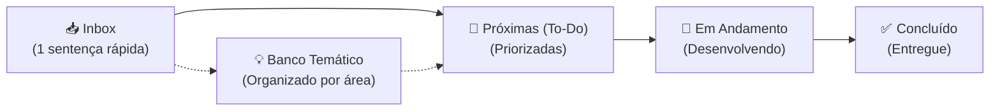

## 📥 Inbox (Captura Rápida)

---

# 📋 Backlog & Banco de Ideias — Alocação Plus

> **Espaço ágil para captura e evolução de ideias, melhorias e tarefas pendentes.**  
> 💡 *Regra de Ouro:* Anote rápido na **Inbox** em apenas uma sentença. O refinamento e o detalhamento acontecem depois, quando for hora de implementar!

---

## ⚡ Fluxo de Trabalho (Workflow)

1. **Capturar:** Teve uma ideia ou notou um ponto de melhoria? Adicione imediatamente uma nova linha em [📥 Inbox (Captura Rápida)](#-inbox-captura-rápida).
2. **Refinar:** Periodicamente, mova itens da Inbox para [🎯 Próximas (To-Do)](#-próximas--prioritárias-to-do) ou para as categorias do [💡 Banco Temático](#-banco-de-ideias--melhorias-futuras-icebox).
3. **Executar:** Ao começar o desenvolvimento, mova para [🚧 Em Andamento](#-em-andamento-in-progress). Ao concluir, marque como feito e mova para [✅ Concluído](#-concluído-done).

> 💡 **Dica de Terminal:** Você também pode anotar ideias direto pelo terminal sem abrir o arquivo:  
> `python tools/gas_sync.py idea "Sua ideia aqui em uma frase"`

---

## 🎯 Próximas / Prioritárias (To-Do)
<!-- Ideias já refinadas e prontas para desenvolvimento nos próximos ciclos -->

---

## 💡 Banco de Ideias & Melhorias Futuras (Icebox)
<!-- Ideias categorizadas para consulta e planejamento estratégico -->

### 🎨 Interface, UX & Mobile
- [x] Exibir mensagem centralizada na mesma linha de "Exibindo xx de xx salas" durante o carregamento dinâmico ("Carregando dados do Jupiterweb/Janus: x%") com cor azul marinho idêntica ao fundo do cabeçalho de salas.
- [ ] Adicionar suporte a Dark Mode respeitando a preferência do sistema operacional (`prefers-color-scheme`).
- [x] Adicionar micro-animações nas transições dos chips de filtros para feedback tátil mais suave.
- [ ] Reparar a barra de rolagem da maior janela para que passe a funcionar no mobile
- [ ] Otimizar a disposição dos cartões de horário em telas pequenas (mobile).

### 🔍 Busca, Filtros & Usabilidade
- [x] Sugerir termos comuns automaticamente no campo de busca ao começar a digitar (chips rápidos de departamentos, docentes e navegação por teclado na v1.4.0).

### ⚡ Desempenho, Cache & Backend

### 🛠️ Automação, DX & Ferramentas
- [ ] Adicionar validação de formatação e lint nos arquivos `.gs` e `.html` antes do envio.
- [ ] Criar script de teste automatizado para validar integridade do parser de células mescladas.
- [x] Criar uma ferramenta de teste automatizado (`tests/run_all_tests.py` com relatórios coloridos e suporte UTF-8/Windows).
---

## 🚧 Em Andamento (In Progress)
<!-- O que está sendo desenvolvido no momento -->

*(Nenhuma tarefa em andamento no momento)*

---

## ✅ Concluído (Done)
<!-- Histórico de melhorias entregues (com indicação da versão) -->

- [x] **v1.5.4:** Otimização de Espaço Vertical, Camadas Sticky da Grade & Refinamento do Cabeçalho:
  - **Camadas Sticky no Scroll Horizontal (`z-index`):** Correção do deslizamento dos cabeçalhos de dias da semana (`.th-dia-header` com `z-index: 25`), que agora passam sob os cabeçalhos fixos de Salas e Lugares (`th.col-fixa-sala` e `th.col-fixa-cap` elevados para `z-index: 35 !important`), eliminando sobreposição visual indesejada;
  - **Refatoração do Botão "Atualizar Dados":** Estilo limpo e harmonizado com o design system via classe `.btn-header-recarregar`, com fundo consistente em outline institucional e micro-interação tátil suave;
  - **Maximização do Espaço Vertical da Grade:**
    - Remoção da barra de rodapé (`.app-footer`), liberando área útil de tela diretamente para exibição das salas e horários;
    - Realocação da identificação de versão (`.badge-versao`) para o cabeçalho superior ao lado do título "Alocação Plus", com estilo discreto sem borda de pílula, tipografia normal (sem negrito) e alinhamento na linha de base do título;
    - Eliminação da linha avulsa `.barra-resultados`, movendo o contador de resultados (`#txt-contador-resultados`) e a barra discreta de progresso de carregamento em segundo plano (`#status-carregamento-dinamico`) para dentro da barra de ações à direita da caixa de busca, economizando mais ~30px verticais;
  - **Responsividade & Alinhamento:** Estilos aprimorados para flexbox com quebra controlada em telas médias/móveis e layout fluido no desktop;
  - Registro de governança arquitetural no ADR 0019.
- [x] **v1.5.3:** Estabilização Dimensional da Caixa de Busca & Limpeza ao Primeiro Toque:
  - Estabilização dimensional definitiva da caixa de busca (`width: 290px;` fixo tanto em repouso quanto em foco), eliminando o salto de 60px (*Cumulative Layout Shift* = 0) e a quebra de alinhamento dos botões vizinhos;
  - Correção cirúrgica do botão de limpar busca (`×`): prevenção de `blur` prematuro via `onmousedown="event.preventDefault()"`, garantindo execução de `limparBusca()` ao primeiro toque (eliminação da necessidade de duplo clique e do deslocamento do botão sob o cursor);
  - Refinamento de alinhamento vertical (`top: 50%; transform: translateY(-50%)`) e dimensões ergonômicas de toque (`20x20px`) do botão `×`;
  - Alinhamento horizontal estrito em linha única dos atalhos rápidos no popover de busca (`.sugestoes-acoes-grid` com `flex-wrap: nowrap`, `white-space: nowrap` e popover expandido para `440px`), garantindo que "Limpar Filtros" permaneça alinhado à direita na mesma linha que "Horário de Agora" e "Focar em Hoje".
- [x] **v1.5.2:** Otimização dos Atalhos Rápidos da Busca & Botão Limpar Filtros:
  - Substituição do atalho "Salas Livres" pelo atalho "Limpar Filtros" (`🧹 Limpar Filtros`) nos chips rápidos de busca quando o campo está vazio;
  - Posicionamento no canto direito do container de atalhos rápidos via alinhamento CSS flexbox (`margin-left: auto`), com estilo sutil e feedback tátil no hover e navegação por teclado (`.chip-acao-direita`);
  - Invocação da rotina canônica `resetarTodosFiltros()` ao acionar o chip de limpeza;
  - Atualização da suíte de testes unitários em `tests/test_autocomplete_logic.py` cobrindo a nova estrutura de ações rápidas (100% de sucesso nos 83 testes).
- [x] **v1.5.1:** Chips da Busca Baseados Exclusivamente na Grade Atual & Resiliência do Estado Vazio:
  - Eliminação completa de listas semente estáticas (`DOCENTES_SEMENTE` e `DISCIPLINAS_SEMENTE`); índices de busca são derivados 100% da grade alocada no momento;
  - Extração canônica e unificada de turmas (`extrairTurmasNumericasDaCelula`) compartilhada entre indexação e filtragem de busca (DRY);
  - Varredura em passo único $O(1)$ da grade compilando disciplinas ativas, turmas ativas e frequências departamentais reais;
  - Filtragem estrita de docentes por turma alocada com fallback seguro para ocorrências sem turma (`temSemTurma`), eliminando chips fantasmas e ocorrências de "0 salas encontradas";
  - Suporte completo a departamentos puramente numéricos do IFSC (código `7600006` mapeado para `760`) e oferecimentos do Janus (`t.ofe`);
  - Ordenação dinâmica dos departamentos frequentes no estado vazio por volume real de aulas alocadas no semestre;
  - Resiliência no estado vazio: orientação contextual ao usuário quando a busca não retorna salas enquanto o carregamento em lote do Júpiterweb/Janus ainda está em execução;
  - Correção de contraste e acessibilidade no botão "Ver Todas as Salas" (`.btn-primary-outline` com cor `#104880` legível sobre fundo claro);
  - Formalização arquitetural no ADR 0018;
  - Expansão da suíte de testes de 72 para 83 testes automatizados (100% de sucesso).
- [x] **v1.5.0:** Coloração Progressiva da Grade, Priorização Geométrica no Viewport 2D & Consolidação do Card Modal:
  - Células da grade iniciam com cores neutras (`.celula-aula-pendente`), transitando suavemente (`transition: 0.4s`) para as tonalidades oficiais (azul céu para graduação e azul cobalto para pós) conforme cada lote é concluído pelo worker em segundo plano;
  - Micro-animação tátil (`celula-recem-carregada`) que sinaliza discretamente a prontidão do card modal;
  - Reestruturação completa do agendador com detecção geométrica do Viewport 2D (interseção das salas visíveis e colunas de horários visíveis no container da tabela);
  - Prioridade 1 estrita para as células atualmente na tela, consumidas na ordem natural de leitura (de cima para baixo, da esquerda para a direita);
  - Prioridade 2 para extensões horizontais, salas abaixo da rolagem e salas filtradas;
  - Reordenação dinâmica real da fila ao rolar a grade (scroll vertical ou horizontal com debounce reduzido para 150ms);
  - Promoção instantânea para Prioridade 0 (urgência máxima) com abertura do card modal em esqueleto animado (*skeleton shimmer*) ao clicar em qualquer disciplina pendente;
  - Remoção da setinha indicadora de link externo (`↗`) nas células da grade (`.celula-aula a`, `.celula-pos a`, `.link-disc`), alinhando o feedback visual com a abertura do Card Modal interno;
  - Preservação das setas `↗` estritamente nos botões de abertura externa no rodapé do Card Modal;
  - Remoção da linha de consultas diretas externas do rodapé da aplicação, mantendo o rodapé limpo e centralizado;
  - Atualização do `title` padrão dos links na geração HTML no backend (`alocacao-plus.gs`);
  - Formalização arquitetural no ADR 0017;
  - Criação da suíte `tests/test_cell_coloring_logic.py` e expansão de `tests/test_queue_logic.py`, totalizando 72 testes automatizados (100% de sucesso).
- [x] **v1.4.0:** Autocomplete Inteligente no Campo de Busca (Departamentos & Docentes):
  - Popover customizado com chips rápidos acessíveis via teclado (`↑`, `↓`, `Enter`, `Esc`) e clique com prevenção de perda de foco;
  - Catálogo abrangente de departamentos da EESC (`SEM`, `SEL`, `SET`, `SEP`, `SMM`, `SHS`, `SGS`, `SAA`, `STT`, `SRB`) e unidades do campus São Carlos (`SMA`, `SME`, `SSC`, `SCC`, `760`, `SLC`, `FMT`, `FFI`, `SQM`, `QFL`, `QIQ`, `QOQ`, `IAU`);
  - Busca semântica por sinônimos e palavras-chave (ex: *"mecânica"* $\rightarrow$ `SEM`, *"elétrica"* $\rightarrow$ `SEL`, *"estruturas"* $\rightarrow$ `SET`, *"cálculo"* $\rightarrow$ `SMA`, *"física"* $\rightarrow$ `760`);
  - Indexação dinâmica e progressiva de docentes em tempo de execução conforme lotes do Jupiterweb e Janus são concluídos em segundo plano;
  - Semente inicial de docentes notáveis/frequentes da EESC para busca instantânea no 1º milissegundo;
  - Normalização e higienização robusta de nomes de professores (remoção de múltiplos títulos acadêmicos como `Prof. Dr.`, `Profa. Dra.`, `Ms.` e anotações como `(R)`);
  - Atalhos rápidos automáticos ao focar no campo vazio (`🚪 Salas Livres`, `⚡ Agora`, `⚡ Focar em Hoje`);
  - Registro de governança arquitetural no ADR 0016;
  - Criação da suíte `tests/test_autocomplete_logic.py`, elevando o total de testes para 58 (100% de sucesso).
- [x] **v1.3.0:** Enriquecimento Progressivo com Dados do Janus (Pós-Graduação):
  - Replicação completa das funcionalidades da Graduação (Jupiterweb) para a Pós-Graduação (Janus) sem regressões;
  - Pipeline otimizado em 2 etapas: busca de metadados da disciplina + resolução automática das turmas ativas sem necessidade de chamadas N+1;
  - Bypass nativo da barreira JSF ViewState com extração direta dos detalhes da turma via endpoint REST e tolerância a charset tipográfico Windows-1252 (`0x96`);
  - Ancoragem semântica robusta nas classes CSS `.intl_*` (resiliente a labels dinâmicos injetados via DWR no cliente);
  - Card Modal responsivo e adaptativo com badge dinâmico Pós-Graduação (`badge-nivel-pos`), link externo contextual ("Abrir no Janus" vs "Abrir no Jupiterweb") e badges semânticos de local de aula e slots de horários com quebra automática de linha;
  - Tooltips de células dinâmicos para pós-graduação ("Sem oferecimento ativo no Janus" vs "Jupiterweb" e nomes de docentes);
  - Busca multicritério inteligente expandida com suporte a modalidades de pós (`Presencial`, `Remota`, `Híbrida`, `EAD`), local de aula (ex: `"sala de aula"`, `"Meet"`), programa de pós-graduação e regex resiliente de turmas (`SEP5864 - 1` casando com `T1`, `t01`, `turma 1`);
  - Governança e arquitetura registradas em `docs/especificacao-parser-janus.md` e `docs/adr/0015-enriquecimento-progressivo-janus.md`;
  - Suíte de testes automatizados expandida para 47 testes (unitários, mocks de rede e fuzzing property-based) com 100% de sucesso.
- [x] **v1.2.2:** Busca Inteligente Multicritério com Resiliência Estruturada:
  - Filtragem de células por sigla da disciplina, nome oficial (Jupiterweb), turma resiliente (`T01`, `t01`, `T1`, `t1`, `T-01`, `t-1`, `T 01`, `turma 1`), docentes (inclusive múltiplos e co-docência), modalidade (`Teórica`/`Prática`, `tv`/`pv`), período (`Semestral`/`Anual`) e qualquer palavra do campo de observações;
  - Extração explícita de `periodo` no parser do Jupiterweb sem exigir cálculos manuais durante a busca;
  - Reatividade imediata da grade ao concluir carregamento em segundo plano de novos lotes de disciplinas;
  - Criação da suíte `tests/test_search_filter.py` totalizando 36 testes com 100% de sucesso.
- [x] **v1.2.1:** Padronização Visual e Micro-Animações Táteis ("Efeitos Fofinhos") nos Botões do Card Flutuante:
  - Eliminação da inconsistência de altura física (2px) entre o botão Fechar e os botões outline no rodapé;
  - Transições em curva de mola `cubic-bezier(0.34, 1.56, 0.64, 1)` com elevação no hover (`translateY(-1px)`) e contração física no clique (`scale(0.96)` / `scale(0.95)` em 0.05s) para todos os botões (turmas inativas e ativas, abrir no Jupiterweb, filtrar grade e fechar);
  - Agrupamento harmonioso no rodapé (link informativo à esquerda e ações operacionais à direita);
  - Criação do ADR 0014 e do guia de Design System `docs/padroes-interface-botoes.md` para governança futura;
  - Suporte completo a `@media (prefers-reduced-motion: reduce)`.
- [x] **v1.2.0:** Telemetria e Contador de Acessos Nativo no Google Sheets:
  - Registro silencioso e assíncrono em segundo plano (0ms de impacto no carregamento e renderização da grade);
  - Identificador anônimo aleatório no `localStorage` para cálculo de visitantes únicos e frequência diária (LGPD-compliant);
  - Detecção automática de tipo de dispositivo (Mobile vs. Desktop) e resolução de tela;
  - Proteção de concorrência via `LockService` e debounce de 15 minutos por sessão contra reloads consecutivos;
  - Criação e formatação automática da aba `_Metricas` na planilha PLUS com fórmulas em tempo real (Total de Consultas, Visitantes Únicos, Acessos Hoje, % Mobile/Desktop);
  - Adição da opção `📊 Abrir Métricas` no menu oficial `💡 Plus` da planilha.
- [x] **v1.0.0:** Primeiro grande lançamento oficial estável (*Major Release*):
  - Enriquecimento progressivo assíncrono de disciplinas com dados oficiais do Jupiterweb (USP);
  - Tooltip dinâmico no hover com docente(s) e Card Modal elegante com turmas, vagas, horários oficiais e observações;
  - Fila reativa com concorrência estrita (1 lote em voo de até 3 disciplinas) e priorização inteligente de viewport;
  - Invalidação completa de cache (cliente `sessionStorage` e servidor `CacheService`) e feedback visual de carregamento ("Conectando à grade oficial do SVGRAD...") ao clicar no botão "Atualizar Dados";
  - Suíte unificada de testes automatizados com 25 testes (unitários, edge cases e property fuzzing) cobrindo parsers, casamento de turmas e máquina de estados da fila.
- [x] **v0.3.0:** Enriquecimento progressivo de disciplinas da graduação com dados do Jupiterweb (motor assíncrono com concorrência estrita de 1 requisição em voo, cache multinível com `sessionStorage` e `CacheService` de 6h, tooltip dinâmico com docente no hover e Card Modal elegante com turmas, distribuição de vagas, horários e observações no clique, mantendo 0ms de tempo de renderização da grade).
- [x] **v0.3.0:** Suíte de testes automatizados unificada (`tests/run_all_tests.py`) com 23 testes unitários e property fuzzing cobrindo parser HTML do Jupiterweb, casamento de turmas e máquina de estados da fila.
- [x] **v0.3.0:** Micro-animações e feedback tátil fluido em todos os botões e links da aplicação (chips de filtros, botões de ação rápida, ações da grade e links de disciplinas do Jupiterweb e Janus na tabela), com suporte completo a `prefers-reduced-motion` e prevenção de atraso de toque em dispositivos móveis.
- [x] **v0.2.0:** Destaque visual do horário vigente e do dia de hoje no cabeçalho (cores temáticas do botão Agora/Hoje, prefixo com símbolo "⚡ " e tipografia em negrito).
- [x] **v0.1.4:** Implementação da sincronização seletiva de arquivos no comando `gas_sync.py push <arquivo>`.
- [x] **v0.1.3:** Estrutura formal de versionamento SemVer (`version.json`) e contador de build automático integrado ao `watch`.
- [x] **v0.1.2:** Suporte a links diretos para turmas no Jupiterweb (graduação) e Janus (pós-graduação).
- [x] **v0.1.1:** Arquitetura de cache multinível em blocos (*chunking*) para contornar o limite de 100KB do `CacheService`.
- [x] **v0.1.0:** Migração da antiga Sidebar para Web App autônomo responsivo.
