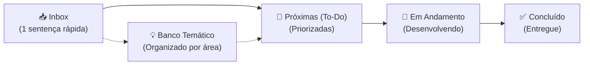

# 📋 Backlog & Banco de Ideias — Alocação Plus

> **Espaço ágil para captura e evolução de ideias, melhorias e tarefas pendentes.**  
> 💡 *Regra de Ouro:* Anote rápido na **Inbox** em apenas uma sentença. O refinamento e o detalhamento acontecem depois, quando for hora de implementar!

---

## ⚡ Fluxo de Trabalho (Workflow)

1. **Capturar:** Teve uma ideia ou notou um ponto de melhoria? Adicione imediatamente uma nova linha em [📥 Inbox (Captura Rápida)](#-inbox-captura-rápida).
2. **Refinar:** Periodicamente, mova itens da Inbox para [🎯 Próximas (To-Do)](#-próximas--prioritárias-to-do) ou para as categorias do [💡 Banco Temático](#-banco-de-ideias--melhorias-futuras-icebox).
3. **Executar:** Ao começar o desenvolvimento, mova para [🚧 Em Andamento](#-em-andamento-in-progress). Ao concluir, marque como feito e mova para [✅ Concluído](#-concluído-done).

> 💡 **Dica de Terminal:** Você também pode anotar ideias direto pelo terminal sem abrir o arquivo:  
> `python tools/gas_sync.py idea "Sua ideia aqui em uma frase"`

---

## 📥 Inbox (Captura Rápida)
<!--
Escreva aqui novas ideias de forma direta e sem fricção (uma sentença por linha).
Exemplo: - [ ] Salvar filtros favoritos no navegador
-->

*(Nenhuma ideia pendente na Inbox)*

---

## 🎯 Próximas / Prioritárias (To-Do)
<!-- Ideias já refinadas e prontas para desenvolvimento nos próximos ciclos -->

---

## 💡 Banco de Ideias & Melhorias Futuras (Icebox)
<!-- Ideias categorizadas para consulta e planejamento estratégico -->

### 🎨 Interface, UX & Mobile
- [ ] Adicionar suporte a Dark Mode respeitando a preferência do sistema operacional (`prefers-color-scheme`).
- [x] Adicionar micro-animações nas transições dos chips de filtros para feedback tátil mais suave.
- [ ] Reparar a barra de rolagem da maior janela para que passe a funcionar no mobile
- [ ] Otimizar a disposição dos cartões de horário em telas pequenas (mobile).

### 🔍 Busca, Filtros & Usabilidade
- [ ] Sugerir termos comuns automaticamente no campo de busca ao começar a digitar.

### ⚡ Desempenho, Cache & Backend

### 🛠️ Automação, DX & Ferramentas
- [ ] Adicionar validação de formatação e lint nos arquivos `.gs` e `.html` antes do envio.
- [ ] Criar script de teste automatizado para validar integridade do parser de células mescladas.
- [ ] Criar uma ferramenta de teste automatizado
---

## 🚧 Em Andamento (In Progress)
<!-- O que está sendo desenvolvido no momento -->

*(Nenhuma tarefa em andamento no momento)*

---

## ✅ Concluído (Done)
<!-- Histórico de melhorias entregues (com indicação da versão) -->

- [x] **v0.2.2 (build 2):** Micro-animações e feedback tátil estendidos a todos os botões da aplicação (Atualizar Dados, Apenas Salas Livres, Limpar Filtros, Apenas colunas com match e botões/links das disciplinas na tabela de horários).
- [x] **v0.2.2 (build 1):** Micro-animações nas transições dos chips de filtros (hover com micro-elevação, compressão tátil no clique/toque `:active`, transição suave de cores e sombras, e suporte a `prefers-reduced-motion`).
- [x] **v0.2.0:** Destaque visual do horário vigente e do dia de hoje no cabeçalho (cores temáticas do botão Agora/Hoje, prefixo com símbolo "⚡ " e tipografia em negrito).
- [x] **v0.1.4:** Implementação da sincronização seletiva de arquivos no comando `gas_sync.py push <arquivo>`.
- [x] **v0.1.3:** Estrutura formal de versionamento SemVer (`version.json`) e contador de build automático integrado ao `watch`.
- [x] **v0.1.2:** Suporte a links diretos para turmas no Jupiterweb (graduação) e Janus (pós-graduação).
- [x] **v0.1.1:** Arquitetura de cache multinível em blocos (*chunking*) para contornar o limite de 100KB do `CacheService`.
- [x] **v0.1.0:** Migração da antiga Sidebar para Web App autônomo responsivo.
