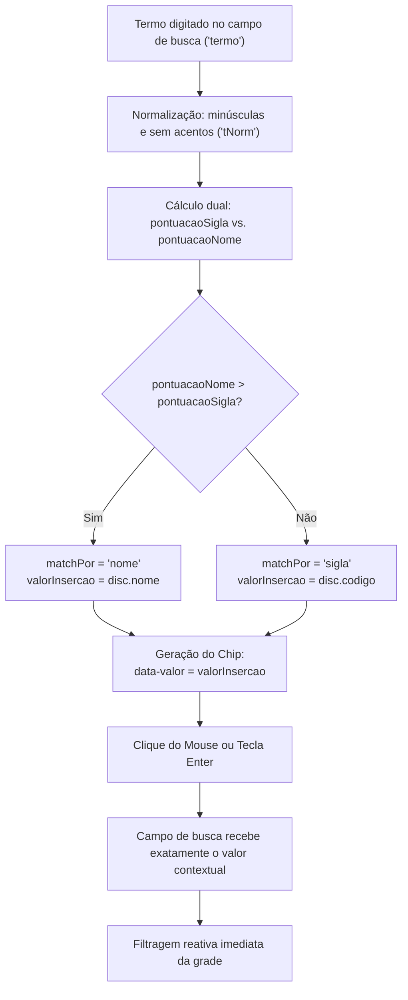

# 22. Inserção Contextual de Nome vs. Sigla nos Chips de Disciplinas do Autocomplete

* **Data:** 2026-09-28
* **Status:** **Aceito**
* **Decisores:** Equipe Alocação Plus (EESC-USP)

## Contexto e Problema

O mecanismo de autocomplete inteligente do campo de busca (ADR 0016 e ADR 0018) indexa dinamicamente os departamentos, docentes e disciplinas presentes na grade horária ativa. Quando o usuário digita na caixa de pesquisa, o dropdown exibe seções com chips interativos de sugestão.

Na implementação anterior, a propriedade `data-valor` de cada chip de disciplina da seção *"📚 Disciplinas"* estava estaticamente associada ao código/sigla da disciplina (`${disc.codigo}`):
```html
<button type="button" class="chip-sugestao chip-disciplina" data-valor="${disc.codigo}" ...>
```

Isso gerava uma ruptura na experiência do usuário (*usability friction*):
1. **Perda de Contexto na Busca por Nome:** Quando o usuário pesquisava pelo nome da disciplina (ex: *"Cálculo"*, *"Resistência"*, *"Física"*), os chips sugeridos exibiam `[SMA0301 • Cálculo I]` ou `[SET0188 • Resistência dos Materiais I]`. Ao clicar no chip, o campo de busca era preenchido invariavelmente com a sigla alfanumérica (ex: `SMA0301`), substituindo de forma abrupta o termo semântico que o usuário havia digitado.
2. **Inconsistência de Intenção:** Se a pesquisa foi iniciada por um termo mnemônico (nome da matéria), a intenção do usuário ao interagir com a sugestão é confirmar e filtrar pelo nome daquela disciplina. Por outro lado, quando o usuário busca por código ou prefixo departamental (ex: *"SMA"*, *"0301"*, *"760"*), a intenção é filtrar pela sigla.
3. **Poluição e Redundância de Tooltips:** O atributo `title` do chip repetia redundâncias como `"Filtrar por SMA0301 (SMA0301 — SMA0301)"` quando a disciplina ainda não havia sido enriquecida pelos dados do Júpiterweb/Janus.

## Decisão Adotada

Adotamos a **Inserção Contextual de Valor nos Chips de Disciplina**, na qual o motor de sugestões avalia deterministicamente se o casamento (*match*) predominante do termo digitado deu-se pela **sigla/código** ou pelo **nome oficial**, atribuindo dinamicamente o valor inserido no campo de busca (`valorInsercao`).

### 1. Escala Dual de Pontuação Intercalada e Não Sobreposta

Refatoramos o cálculo de relevância em `buscarSugestoes(termo)` para isolar duas pontuações independentes:

* **Pontuação de Sigla (`pontuacaoSigla`):**
  * Casamento exato (`codNorm === tNorm`): **100**
  * Prefixo de código (`codNorm.startsWith(tNorm)`): **85**
  * Substring de código (`codNorm.includes(tNorm)`): **55**

* **Pontuação de Nome (`pontuacaoNome`):**
  *(Calculada apenas quando `disc.nome` existir e for distinto de `disc.codigo`)*
  * Casamento exato de nome (`nomeNorm === tNorm`): **95**
  * Início do nome da disciplina (`nomeNorm.startsWith(tNorm)`): **75**
  * Início de palavra interna (`partesNome.some(p => p.startsWith(tNorm))`): **65**
  * Substring em qualquer posição (`nomeNorm.includes(tNorm)`): **45**

A pontuação final da disciplina é `pontuacao = Math.max(pontuacaoSigla, pontuacaoNome)`.



### 2. Resolução de Colisões e Desempate Determinístico

1. **Garantia Matemática de Desempate entre Sigla e Nome:**
   Como os conjuntos de pontuação são disjuntos ($\{100, 85, 55\} \cap \{95, 75, 65, 45\} = \emptyset$), nunca ocorre empate entre casamento por sigla e casamento por nome para pontuações não nulas.
2. **Prioridade em Colisões de Prefixo:**
   Se um termo de 3 letras casa simultaneamente como sigla departamental (ex: `"SEM"` em `SEM0500`) e prefixo de nome (ex: `"Seminários"`), a sigla prevalece deterministricamente ($85 > 75$), respeitando a convenção de que códigos de departamento são a intenção primária ao digitar acrônimos de 3 letras.
3. **Desempate Estável entre Disciplinas:**
   Caso duas disciplinas atinjam a mesma pontuação (ex: ambas começam com *"Cálculo"*), a ordenação aplica desempate alfanumérico pelo código (`b.pontuacao - a.pontuacao || a.codigo.localeCompare(b.codigo)` em JS e `(-x["pontuacao"], x["codigo"])` em Python), assegurando estabilidade determinística entre renders e testes.
4. **Resiliência para Disciplinas sem Enriquecimento:**
   Quando a disciplina ainda não recebeu dados do Júpiterweb/Janus (`nome == null` ou `nome === codigo`), `pontuacaoNome` é forçada a 0, assegurando fallback para inserção do código com `matchPor = 'sigla'`.

### 3. Template HTML do Chip e Tooltip Semântico

O template do botão `.chip-disciplina` em `atualizarSugestoesBusca` foi atualizado com escape seguro de caracteres para prevenir quebras de atributos com aspas ou ampersands:
```html
<button type="button" 
        class="chip-sugestao chip-disciplina" 
        data-valor="${escapeHtml(valorIns)}" 
        data-tipo="disciplina" 
        title="${tooltip}">
  <span class="chip-sugestao-sigla">${escapeHtml(disc.codigo)}</span>
  <span class="chip-sugestao-rotulo">${escapeHtml(disc.nome)}</span>
</button>
```

O *tooltip* (`title`) foi refinado para eliminar redundâncias visuais:
* **Quando há nome enriquecido:** `title="Filtrar por ${escapeHtml(valorIns)} (${escapeHtml(disc.codigo)})"`
* **Quando sem enriquecimento:** `title="Filtrar por ${escapeHtml(valorIns)}"`

## Consequências

### Positivas (+)
* **Continuidade Cognitiva:** O usuário que busca por *"Cálculo"* ou *"Resistência"* tem sua busca preenchida com o nome inteligível da matéria ao invés de códigos técnicos opacos.
* **Preservação da Busca por Sigla:** Usuários experientes que buscam por código (`SMA`, `SMA0301`, `0301`, `760`) continuam recebendo a sigla diretamente no input.
* **Compatibilidade Transparente:** Clicks e navegação por teclado (`ArrowDown`, `ArrowUp`, `Enter`) utilizam `chip.dataset.valor`, operando sem qualquer necessidade de novos event listeners.
* **100% Coberto por Testes:** Suíte de testes automatizados espelhada em Python garantindo validação de todos os casos típicos, colisões, casos de borda e regressão total (113 testes passando).

### Negativas / Trade-offs (-)
* **Casamento por Subtermo em Tokens Curtos na Grade:** Ao inserir nomes de disciplinas que contêm algarismos romanos ou letras isoladas (ex: o token `'i'` em *"Cálculo I"* ou *"Resistência dos Materiais I"*), o filtro `celulaCorrespondeABusca` opera por inclusão de tokens em strings normalizadas. Para isolamento estritamente unívoco de uma única turma, o usuário pode selecionar ou digitar o código da disciplina.

## Referências no Código
* [`src/scripts.html`](file:///d:/OneDrive/EESC/Documents/SCAE/code/alocacao-plus/src/scripts.html) — `buscarSugestoes` e `atualizarSugestoesBusca`
* [`tests/test_autocomplete_logic.py`](file:///d:/OneDrive/EESC/Documents/SCAE/code/alocacao-plus/tests/test_autocomplete_logic.py) — Espelho de testes do motor de busca
* [`tests/run_all_tests.py`](file:///d:/OneDrive/EESC/Documents/SCAE/code/alocacao-plus/tests/run_all_tests.py) — Orquestrador central da suíte de testes
