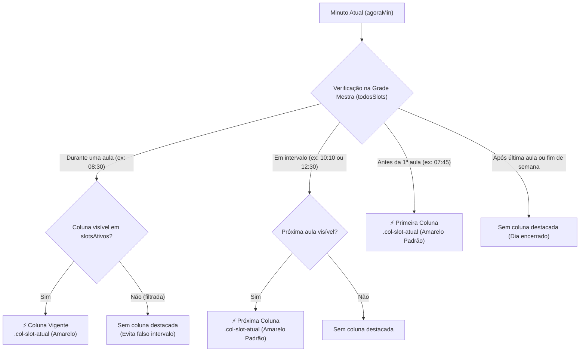

# 23. Destaque do Próximo Bloco de Horário Durante Intervalos e Pré-Expediente na Grade

* **Data:** 2026-09-30
* **Status:** **Aceito**
* **Decisores:** Equipe Alocação Plus (EESC-USP)

## Contexto e Problema

Na visualização da grade horária semanal em [`src/scripts.html`](file:///d:/OneDrive/EESC/Documents/SCAE/code/alocacao-plus/src/scripts.html), o cabeçalho da coluna correspondente ao horário corrente recebe um destaque visual padronizado (`col-slot-atual`, fundo amarelo suave e ícone de raio `⚡ `).

No entanto, a função legada `obterIndiceSlotAtual(slotsAtivos)` localizava apenas slots onde o relógio estava estritamente contido no intervalo de aula:

$$\text{horaInicioMin} \le \text{agoraMin} < \text{horaFimMin}$$

Nos intervalos entre períodos letivos regulares na EESC-USP (como o recesso matutino das **10:00 às 10:20**, o horário de almoço das **12:00 às 14:20**, o recesso vespertino das **16:10 às 16:20** e o intervalo da noite das **18:00 às 19:00**), a condição falhava para todos os slots. O retorno era `-1`, fazendo com que **nenhuma coluna recebesse destaque**, deixando o usuário sem um ponto focal imediato de orientação temporal ao abrir o sistema durante os intervalos.

Adicionalmente, verificou-se que simplesmente buscar a "próxima coluna visível" em `slotsAtivos` causava graves **falsos positivos em grades filtradas** (por exemplo, quando uma busca textual ou filtro de horário ocultava a aula em andamento, o algoritmo erroneamente rotulava o próximo horário horas depois como intervalo).

## Decisão Adotada

Adotamos a **Resolução Temporal com Grade Mestra e Destaque Unificado do Próximo Bloco**, mantendo 100% da identidade visual padrão existente (`col-slot-atual`, `⚡ `) sem introduzir novas classes CSS ou elementos de tag no DOM.

### 1. Resolução Temporal Referenciada na Grade Mestra do Campus

Substituímos `obterIndiceSlotAtual` pela função pura `obterEstadoTemporalGrade(slotsAtivos, todosSlots, agoraCustom)`. A avaliação do estado acadêmico (`aula`, `intervalo`, `pre_expediente`, `pos_expediente`, `fora_dia`) é realizada primariamente contra a **grade mestra de horários (`todosSlots`)**:

1. **Aula Ativa (`tipo: 'aula'`):** Se `agoraMin` estiver contido em qualquer slot da universidade hoje, a prioridade é marcar aula ativa. Se essa coluna estiver visível em `slotsAtivos`, recebe a classe `.col-slot-atual` com ícone `⚡ `. Se a coluna estiver oculta por filtro de busca, nenhuma outra coluna é destacada.
2. **Intervalo Acadêmico Real (`tipo: 'intervalo'`):** Se o campus estiver entre dois períodos letivos, localiza o próximo slot da universidade. Se ele estiver visível em `slotsAtivos`, sua coluna recebe o mesmo destaque padrão `.col-slot-atual` com ícone `⚡ `, e tooltip enriquecido com a contagem regressiva inteligente (`formatarTempoRestanteGrade`).
3. **Pré-Expediente (`tipo: 'pre_expediente'`):** Antes do primeiro horário do dia, a primeira aula visível recebe a classe `.col-slot-atual` com ícone `⚡ `.
4. **Pós-Expediente / Fim de Semana (`tipo: 'pos_expediente' | 'fora_dia'`):** Retorna `idxSlot = -1` sem destacar nenhuma coluna.

### 2. Preservação Estrita do Design System Existente

Não foram criadas regras de estilo adicionais em `src/estilos.html`. Todo o destaque é conduzido pela classe `.col-slot-atual`, garantindo simplicidade, uniformidade estética com os botões "Agora/Hoje" e total ausência de deslocamento de layout (zero CLS).

### 3. Formatação Humana de Tempo Restante no Tooltip

Criamos a função `formatarTempoRestanteGrade(minutos)` para enriquecer o atributo `title` do cabeçalho de forma intuitiva:
* Menos de 60 minutos: `em 15 min`, `em 1 min`
* 60 minutos ou mais: `em 1h`, `em 2h 20min`

## Consequências

### Positivas
* **Orientação Temporal Contínua:** Durante recessos ou antes do início das aulas, o próximo bloco de horários já fica destacado com a cor amarela e ícone `⚡ `, eliminando a sensação de "grade inativa".
* **Imunidade a Falsos Positivos:** Grades filtradas por busca textual de disciplina nunca geram destaques espúrios quando a aula atual está oculta.
* **Simplicidade e Coerência Visual:** Nenhuma cor nova ou badge foi adicionado; a interface permanece limpa e consistente com os padrões visuais já conhecidos pelos usuários.
* **Confiabilidade:** 100% testado por meio de suíte automatizada unitária e property-based fuzzing em todos os 1.440 minutos do dia.
